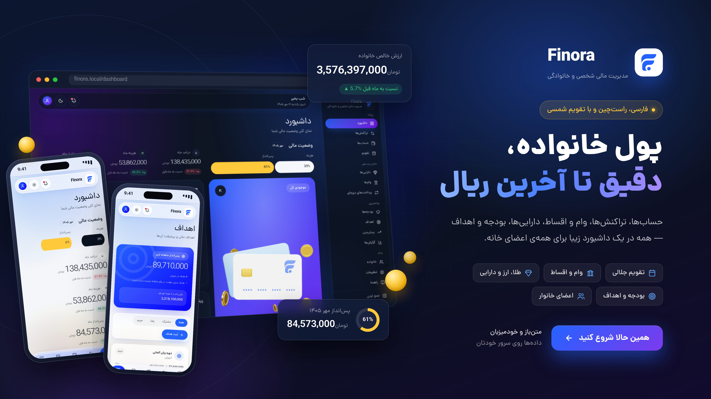

# Finora showcase

Full-resolution screenshots of every major section, taken from a production
build (`npm run build && npm run start`) with a year of fake household data
(1404/08 – 1405/07) entered through the application's own API. Captured with
Playwright at 1440 px wide, device scale factor 2.

| File | Section |
| --- | --- |
| `finora-banner-3840x2160.png` | Mockup banner (3840×2160) |
| `01-dashboard.png` | Dashboard, light theme |
| `02-dashboard-dark.png` | Dashboard, dark theme |
| `03-transactions.png` | Transactions |
| `04-accounts.png` | Accounts |
| `05-assets.png` | Assets, dark theme |
| `06-loans.png` | Loans and instalments |
| `07-budgets.png` | Budgets |
| `08-goals.png` | Savings goals, dark theme |
| `09-reports.png` | Reports, category analysis |
| `10-calendar.png` | Jalali calendar |

